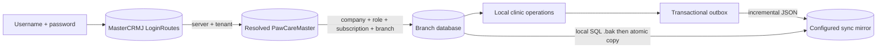
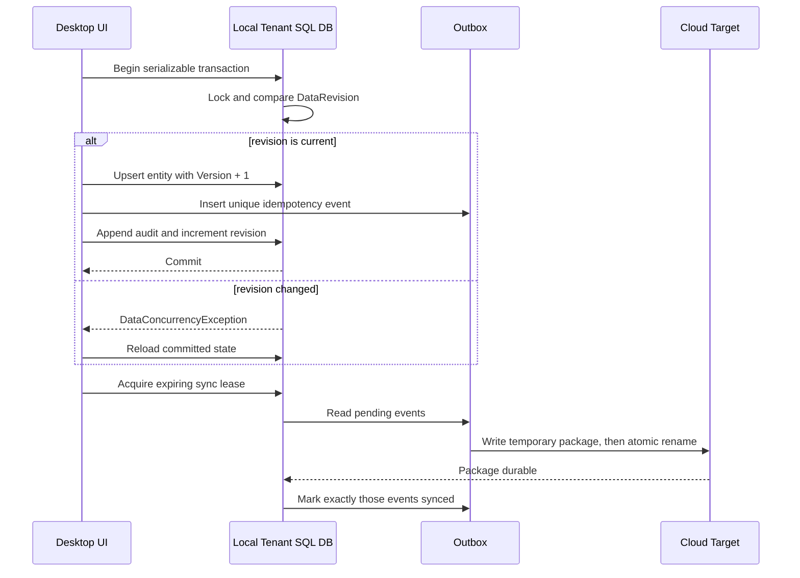

# PawCare Process and SQL Server Architecture

## System flow

Each configured SQL Server instance has an independent master and tenant/branch database set. The selected branch database is authoritative for clinic operations. Subscription settings in that instance's master database determine which modules are available. Cloud availability is not part of the operational request path.

## Sign-in sequence

1. The user enters a globally unique username and password; no server selector is shown.
2. The central `MasterCRMJ` directory resolves the username to an active company database registration, SQL Server, and tenant.
3. The resolved server's `PawCareMaster` verifies a PBKDF2-SHA-512 password hash using constant-time comparison and confirms that the account's tenant matches the central route.
4. That server's master database returns the role, organization, subscription, and user identity.
5. If the company has multiple active branches, the user selects a branch. The app connects to that branch's operational database. Super Admin selects a company and branch for sync/backup work.
6. The sidebar and save operations require both role permission and subscription entitlement. A plan change does not delete existing records.

## Initial database layout per server

| SQL Server database | Responsibility | Scope |
|---|---|---|
| `PawCareMaster` | Organizations, branches, subscriptions, users, hashes, roles, master audit | Identity and authorization on that server |
| `PawCareTenantA` | PawCare Makati data | Tenant A only |
| `PawCareTenantB` | PawCare Taguig data | Tenant B only |
| `PawCareTenantC` | PawCare Quezon City data | Tenant C only |

Each tenant database has separate `Inquiries`, `Complaints`, and `Feedback` tables plus operational entity, audit, outbox, metadata, and lease tables.

The database names follow their responsibilities: `MasterCRMJ` is the one central company/routing directory, each SQL profile has one `PawCareMaster` identity and authorization database, and `PawCareTenant*` databases contain isolated branch operations. This keeps the professor's master/tenant pattern while making the deployment scope explicit.

Archived appointments remain in the tenant's `Appointments` table with `IsDeleted=1`; they are not copied into a second archive table. Restoring one reactivates the same ID, increments its version, appends a `Restore` audit/outbox event, and returns it to the active schedule. ID generation includes archived rows so a new record cannot reuse an archived appointment's key.

Full Clinic organizations can add branches from Super Admin's **Tenant branches** page or from the organization's branch administrator page. Each extra branch receives a readable isolated operational database name based on its tenant database and branch code, such as `PawCareTenantC_NORTH`. Sync packages and idempotency keys include the branch ID. In the seeded exam setup, Tenant A and Tenant B remain single-branch because Main Transaction and Promotional do not include the Branching feature; Tenant C can branch because it uses Full Clinic. If Super Admin later assigns Full Clinic to another tenant, that tenant gains the same capability without changing its identity.

## Seeded subscriptions

| Example company | Plan | Included modules |
|---|---|---|
| Tenant A | Main Transaction | Client profiles, appointments, inquiries, complaints, feedback, six-view business intelligence, consultations, medical records, staff access, and full backup |
| Tenant B | Promotional | Main Transaction plus reminders, satisfaction views, promotional offers, approval, campaign tracking, and campaign conversion intelligence |
| Tenant C | Full Clinic | Promotional plus inventory, reports and exports, incremental sync, and multiple branches |

Super Admin edits plan module flags and branch limits under Subscriptions, then assigns a plan under Organizations. The role matrix below still limits actions within an enabled module.

### Main Transaction in daily use

The Main Transaction plan enables **Collection, Clients, Appointments, Clinical, and Backup** features for one branch. Tenant A is the seeded example. Staff access and audit are core governance functions. The three collection types are kept separate in its operational database: inquiries, complaints, and feedback.

1. The receptionist creates a client and patient profile, books a visit, and logs questions as inquiries with a subject, priority, owner, status, and follow-up date. An inquiry marked **Follow-up** requires a date.
2. The receptionist records a complaint, ordinary feedback, or compliment, including the client's account, category, rating, priority, assigned owner, and response plan. Urgent complaints require an escalation choice. A case cannot be closed until its resolution is documented.
3. The manager monitors appointments, satisfaction, complaints, escalations, inquiry follow-ups, and the six-view business intelligence report. Branch administrators can use the same evidence-based report for governance; receptionists continue working from operational queues without report access. Due counts include overdue records, so missed commitments remain visible until resolved or closed.
4. The veterinarian sees assigned visits and records consultations, treatment, medical notes, and vaccinations. The branch administrator manages staff access and oversees client cases.

Main Transaction includes business intelligence and detailed reports, but it does not include campaign creation, scheduled reminder records, the dedicated satisfaction module, inventory, incremental sync, or extra branches. Its branch administrator can create a full SQL backup. Appointment email drafts are available from an appointment record, but SMS and Messenger delivery still require an external provider. The Super Admin can change a company's subscription; existing records remain stored when features change. A tenant is the company, not its plan: A, B, and C are examples and can be reassigned.

### Promotional campaign flow

1. A receptionist or branch administrator creates a campaign draft with a unique offer code, measurable goal, audience rule, supported channel, and valid schedule. Audience preview applies the selected rule to consented client records and reports email-, phone-, and delivery-ready counts without sending anything.
2. The creator explicitly submits the draft for review. Only a branch administrator can approve it or request changes with a required reason. Editing reviewed terms returns the campaign to draft and clears the previous decision.
3. Approval activates a campaign whose start date has arrived or schedules a future campaign. An approved scheduled campaign can be started only within its valid date range.
4. Email delivery opens protected BCC batches of at most 25 recipients. SMS delivery copies a deduplicated batch and message for an approved external SMS provider. PawCare records reach only after the user confirms that a prepared batch was sent; previously contacted client IDs are excluded from later batches.
5. Staff may add reach from other verified delivery channels and record claims only after launch. Claims cannot exceed reach, and conversion is recalculated from the recorded totals. An active campaign can then be completed while retaining its review, delivery, audit, and performance history.

## Actor and module ownership

| Module | Receptionist | Manager | Veterinarian | Admin/Owner | Super Admin |
|---|:---:|:---:|:---:|:---:|:---:|
| Dashboard | ✓ | ✓ | ✓ | ✓ | ✓ |
| Client and patient management | ✓ | View | Clinical use | ✓ | — |
| Appointment management | ✓ | ✓ | Assigned visits | ✓ | — |
| Inquiry collection | ✓ | Reports | — | Oversight | — |
| Complaint/feedback collection | ✓ | Escalate/review | — | Oversight | — |
| Consultation/treatment | — | — | ✓ | — | — |
| Medical/vaccination records | — | — | ✓ | — | — |
| Inventory | — | — | Review/update | ✓ | — |
| Promotions/communication | ✓ | Reports | — | ✓ | — |
| Satisfaction analytics | — | ✓ | — | ✓ | — |
| Business intelligence & detailed reports | — | ✓ | — | ✓ | — |
| Branch staff roles | — | — | — | ✓ | — |
| Branch administrator assignment | — | — | — | — | ✓ |
| Audit and access governance | — | — | — | Branch | Global |
| Cloud backup | — | — | — | Branch | Select branch |
| Incremental sync (Full Clinic) | — | — | — | Branch | Select branch |

Authorization is enforced in services and the UI. A branch Admin can create or edit Receptionist, Manager, and Veterinarian accounts only for their tenant. Only Super Admin can assign the Admin role.

## Main transaction collections

Receptionist inquiry intake records the client, contact, patient, channel, category, subject, details, priority, status, preferred contact channel, consent, owner, and follow-up date.

Complaints are stored separately from general feedback. They include client/contact/patient, source, rating, category, priority, details, status, escalation, follow-up consent, owner, due date, and resolution notes.

Feedback and compliments use their own table while retaining satisfaction, review, follow-up, and reporting fields. The experience screens combine complaint and feedback views without merging their database collections.

## Race-condition and integrity controls

- Serializable transactions and `UPDLOCK/HOLDLOCK` serialize revision checks and writes.
- `DataRevision` blocks stale in-memory sessions from overwriting newer branch data.
- Per-entity versions and unique `TenantId:EntityType:EntityId:Version` keys make sync events idempotent.
- Master user updates use optimistic version checks.
- Sync and backup share an expiring per-tenant lease.
- Local data, audit history, and the outbox event commit atomically.
- Outbox events are marked synced only after the incremental package is durably renamed.
- Cloud backup uses SQL Server `BACKUP DATABASE ... WITH COPY_ONLY, CHECKSUM`, preserves a local SSMS-restorable `.bak`, then atomically copies it to the configured cloud mirror.

## Development cloud adapter

The development adapter stores incremental JSON envelopes and SQL Server `.bak` files under `%LOCALAPPDATA%\PawCare\data\cloud-sync-simulator`. The SQL Server service account has modify access only to this destination.

For production, replace the destination operations with authenticated cloud object storage or SQL Server backup-to-URL. Retain TLS, encryption at rest, tenant-scoped credentials/object prefixes, immutable retention, idempotency enforcement, retry/backoff, monitoring, and regular restore drills.
